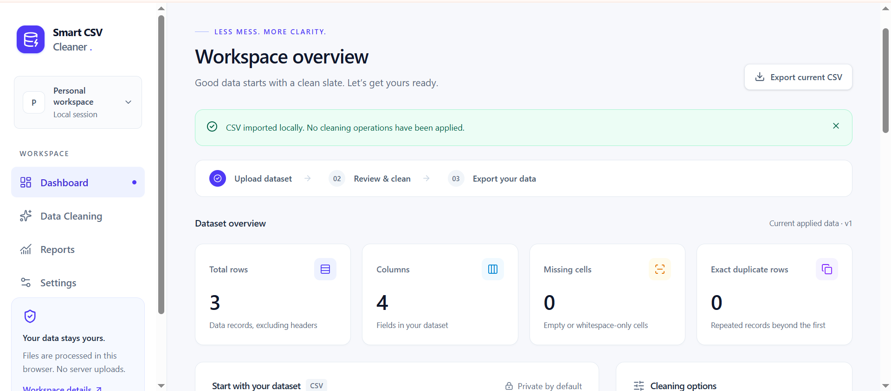
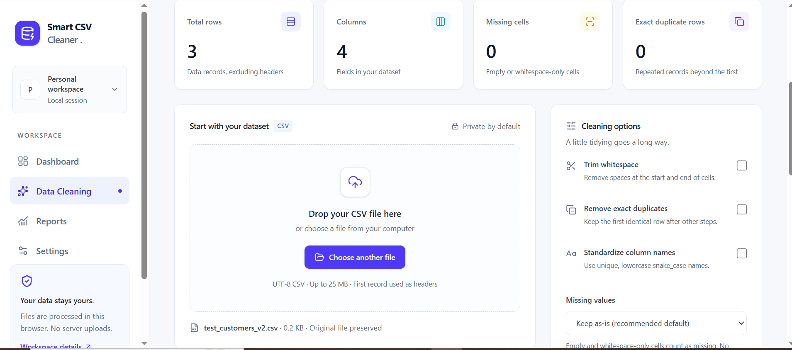
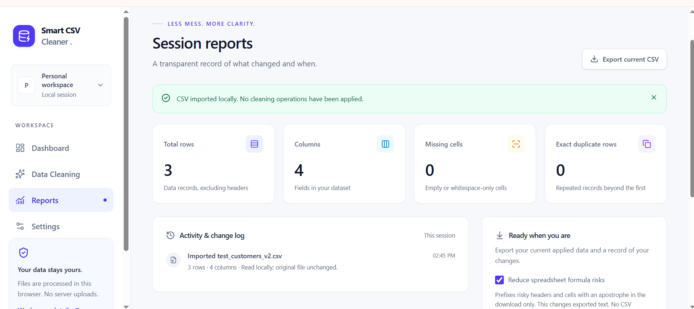

# Smart CSV Cleaner · Version 2

**Inspect, clean, and export CSV data in your browser—with a reviewable record of every applied change.**

[Live Demo](https://smart-csv-cleaner.vercel.app) · [GitHub Repository](https://github.com/zainabmughal098/smart-csv-cleaner) · [Technical Guide](frontend/README.md) · [Large-File Validation](frontend/LARGE_CSV_RESULTS.md)

Created by **Zainab Salman**.

> This README describes the Version 2 implementation inspected on `feature/large-csv-support`. The linked live site's deployed revision has not been independently verified against this checkout. Local validation results below are not hosted acceptance results.

## Overview

CSV exports often arrive with padded text, inconsistent column names, missing values, and repeated records. Cleaning them manually can introduce errors and make it difficult to explain what changed.

Smart CSV Cleaner provides a local workspace for inspecting these issues, proposing explicit transformations, reviewing their impact, and downloading the applied result with a detailed JSON change log. The project combines a React interface with browser-side data processing; it requires no application backend, database, account, or API key.

## Features

| Workflow | Implemented behavior |
| --- | --- |
| Import | File picker and drag-and-drop for UTF-8, comma-delimited CSV, with strict validation and understandable errors. |
| Inspect | Real row, column, missing-cell, and exact-duplicate metrics; paginated original/current previews with stable source-row references. |
| Clean | Trim cell whitespace, normalize column names, remove exact duplicate rows, and explicitly keep, fill, or remove rows with missing values. |
| Review | Separate proposed and applied results, impact metrics, and the first eight proposed cleaning steps. Applying changes requires confirmation. |
| Preserve | Keep the original uploaded dataset available; confirm before replacing the workspace or restoring the original. The source file is never written. |
| Export | Download the current applied CSV or a JSON session log. Pending proposals are excluded. Formula-risk reduction is enabled by default. |
| Audit | Record applied options, summaries, exact before/after values, removals, source-row IDs, version transitions, and session/export events. |

The interface includes Dashboard, Data Cleaning, Reports, and Settings views, responsive navigation, keyboard-accessible controls, and useful empty/error states.

### Cleaning rules

Operations run in this order: **column normalization → whitespace trimming → missing-value handling → exact deduplication**.

- **Trim:** remove leading/trailing whitespace while preserving interior whitespace.
- **Normalize headers:** create unique lowercase snake_case names, with collision suffixes and fallback names for blank headers.
- **Missing values:** keep them by default, fill with a chosen nonblank string, or remove affected rows only when explicitly selected. Empty and whitespace-only strings count as missing; literal `NA` and `null` do not.
- **Deduplicate:** retain the first exact row after preceding selected operations. Values are compared as strings without numeric/date coercion.

Leading zeros and large numeric identifiers remain strings. Quoted commas, doubled quotes, multiline fields, UTF-8 BOMs, and LF/CRLF/CR or mixed record endings are supported. Duplicate headers remain intact until normalization is selected.

## Version 2: larger files, bounded processing

Version 2 moves parsing, analysis, cleaning proposals, and export serialization into a dedicated **Web Worker**. Files are decoded in 256 KiB slices; Papa Parse receives batches of complete logical records. React receives bounded previews and summaries rather than full copies of the dataset. Unchanged rows share references internally while the original is preserved.

The interface reports phase-specific byte/row/entry progress and supports **cooperative cancellation before commit or download**. Failed or cancelled work leaves the applied dataset/history unchanged. Large individual records can delay cancellation; there is no fixed cancellation-latency guarantee. Confirmed commit steps cannot be cancelled once committed.

### Import limits

All limits are inclusive and apply together:

| Limit | Version 2 bound |
| --- | ---: |
| File size | **25 MiB — 26,214,400 bytes**; displayed as 25 MB in the interface |
| Data rows | **100,000**, excluding the header |
| Columns | **200** |
| Data cells | **1,000,000**, including missing cells |

For example, 100,000 rows × 10 columns reaches the cell limit; 100,000 × 200 does not fit. Oversized files are rejected before reading. Reduce a sample by complete CSV records, not physical lines, because quoted fields can contain newlines.

### Display and operation budgets

- Preview pages contain at most **1,000 data cells**; wide datasets therefore show fewer rows per page. Preview strings are capped at **500 UTF-16 code units** without splitting surrogate pairs.
- The proposal view shows the first **eight** steps; activity shows the latest **100** event summaries. Complete applied values and events remain available in the JSON export.
- Proposals are limited to **250,000 detailed changes** and **32 MiB serialized detail**; retained session history has a **64 MiB serialized accounting** budget.
- Proposed dataset text is limited to **33,554,432 UTF-16 code units**; each encoded CSV/JSON export is capped at **128 MiB**.

These are logical safeguards, not a hard browser-memory ceiling. A valid import may still have an expensive transformation rejected—for example, logging both the original and trimmed version of a nearly 25 MiB field exceeds the proposal budget. Such operations fail explicitly rather than silently dropping log details. Exports may exceed the import size limit.

**50 MiB files are not supported by the application.** They were evaluated using a separate, relaxed benchmark-only profile. The complete dataset, history, and export Blobs still reside in memory; this is not disk-backed or unlimited streaming. See the [architecture decisions](frontend/LARGE_CSV_ARCHITECTURE.md) and [measured results](frontend/LARGE_CSV_RESULTS.md).

## Tech stack

Verified from [`frontend/package.json`](frontend/package.json), the Vite configuration, and source code:

| Area | Technology |
| --- | --- |
| Interface | React 19, JavaScript, JSX |
| Development and build | Vite 8 with the React plugin |
| Styling | Tailwind CSS 4 through `@tailwindcss/vite` |
| Icons | Lucide React |
| CSV parsing/export | Papa Parse 5 |
| Local processing | Module Web Worker, File/Blob APIs, streaming UTF-8 decoding |
| Unit/regression tests | Node.js built-in test runner |
| Browser/accessibility checks | Playwright and axe-core |
| Static hosting | Vercel live-demo link; hosted Version 2 behavior not verified here |

There is no FastAPI, Pandas, authentication, database, or cloud-upload implementation in this version.

## Run locally

Use **Node.js 24.x** and npm, matching `frontend/.nvmrc` and `engines.node`. No `.env` file or secrets are required.

Clone the repository and enter the frontend directory:

```bash
git clone https://github.com/zainabmughal098/smart-csv-cleaner.git
cd smart-csv-cleaner/frontend
npm ci
npm run dev
```

For Version 2 behavior, use a checkout containing the worker implementation described above; the inspected branch is `feature/large-csv-support`. Do not assume an older checkout has these limits.

For the existing Windows workspace, start from:

```powershell
cd F:\smart_csv_cleaner\frontend
npm ci
npm run dev
```

Open the URL printed by Vite, normally **http://localhost:5173/**. All npm commands run inside `frontend/`.

To build and inspect the production output locally:

```bash
npm run build
npm run preview
```

The build writes `frontend/dist/`. The preview command serves that output locally; it does not deploy it.

## How to use

1. **Choose a CSV.** Drop one UTF-8 CSV onto the upload area or use the file picker. Wait for validation and the initial metrics.
2. **Inspect the data.** Review missing cells and exact duplicates, page through records, and compare original/current views. Source-row IDs identify original data records, not physical file lines.
3. **Select operations.** Enable only the cleaning rules you want. Missing values remain unchanged unless you explicitly choose another strategy.
4. **Review the proposal.** Check before/after metrics and proposed steps. Current data stays unchanged while the proposal is calculated. Cancel processing if needed; use **Recalculate proposed preview** to retry a cancelled/rejected plan.
5. **Confirm application.** Choose **Review & apply changes** and approve the summary. The working version changes; the original upload remains available.
6. **Download results.** Export the applied CSV and JSON change log. Review the formula-protection notice if relevant. An export event records a download request, not proof that the browser saved the file.
7. **Save before leaving.** Download anything needed before refreshing, closing, or replacing the session. Restore-original and replacement operations require confirmation.

For a small smoke test, use [`edge-cases.csv`](frontend/tests/fixtures/edge-cases.csv). Initial metrics should be **3 rows, 4 columns, 2 missing cells, and 1 exact duplicate**.

## Privacy and export safety

CSV processing is local to the browser. The inspected application code does not upload CSV contents, filenames, or change logs to an API, log dataset contents to the console, or integrate analytics/session replay. It does not persist the workspace in localStorage or IndexedDB. Normal page/asset requests still reach the hosting provider; hosting infrastructure, extensions, device access, and downloaded files are outside the application's privacy boundary.

Original files are read only. Session data is held in memory and is lost on reload, tab closure, or worker failure. There is no autosave or crash recovery. **The downloaded JSON log contains sensitive exact before/after values and source metadata**; handle it like the original dataset.

CSV quoting alone does not prevent spreadsheet formula execution. Default export protection prefixes detected formula-risk headers/cells with an apostrophe, changing downloaded text only. This may also affect negative numeric strings. Raw export with detected risks requires a warning confirmation. Protection is risk reduction, **not a guarantee across spreadsheet products or save/reopen workflows**; inspect untrusted files carefully. See the [detailed export behavior](frontend/README.md#formula-injection-and-exports).

## Testing and validation

The [Version 2 results report](frontend/LARGE_CSV_RESULTS.md), dated **2026-11-14**, records the following local results. These are documented prior runs, not a claim that tests ran automatically when this README was written.

| Check | Documented result |
| --- | --- |
| Unit/regression suite | **44 passed** |
| Production-preview browser suite | **21 passed** |
| ESLint | Passed |
| Production build | Passed; separate worker asset emitted |
| Synthetic benchmarks | **20 cases**: 12 worker cases with CSV/log verification and 8 baseline comparisons |

Coverage includes quoted/multiline CSV, UTF-8 chunk boundaries, mixed line endings, malformed input, inclusive limits, all cleaning strategies, immutable originals, stale proposals, cancellation, resource-budget failures, formula protection, complete CSV round-trips, and applied JSON log replay. Browser checks include keyboard navigation, layout widths from 320 to 1440 pixels, and automated axe accessibility rules.

Benchmarks used Windows desktop Edge 157, an Intel i5-6200U, approximately 8 GB RAM, and two repetitions per case. They covered exact 5/10/25 MiB files, 100,000-row and 200-column/million-cell shapes, plus experimental 50 MiB inputs. Results support a bounded 25 MiB desktop beta; they do not establish universal device performance. Heap figures are sampled JS heap, not true total process peak memory. Worker processing is not uniformly faster in wall-clock time.

Run the checks from `frontend/`:

```bash
npm test
npm run lint
npm run build
npm run test:e2e
```

Browser tests require Microsoft Edge installed and port **4173** available; Playwright starts the local production preview. Build first. The optional `npm run benchmark` also requires Edge, port **4174**, and baseline commit `06ebe60` in local history. It generates synthetic data and overwrites the aggregate [benchmark results](frontend/tests/benchmarks/results.json).

The [original release audit](frontend/RELEASE_AUDIT.md) documents the earlier 5 MiB profile and should be read as historical evidence.

## Known limitations

- **Browser evidence:** automated validation targets Microsoft Edge on Windows, including narrow viewport sizes. Safari, Firefox, actual iOS/Android devices, and manual screen-reader use have not been qualified by these reports.
- **CSV scope:** UTF-8 comma-delimited files with the first record as headers. Semicolon/tab dialects, Excel workbooks, non-UTF-8 encodings, and malformed quoting are unsupported.
- **Session scope:** in-memory processing only; no persistence, collaboration, account system, undo stack, or worker-crash recovery. Restoring the original replaces the working version while retaining prior session history.
- **Resource scope:** long values, expansion, repeated transformations, and full audit history can exhaust operation budgets even below the import limits. Cooperative cancellation can be delayed by individual expensive operations.
- **Accessibility/security evidence:** automated checks do not replace manual accessibility testing or a complete security assessment. Spreadsheet execution and the live deployment's worker/CSP behavior were not validated by the local reports.

## Screenshots

### Dashboard

Dataset overview showing row and column counts, missing cells, exact duplicates, and the upload-to-export workflow.



### Data Cleaning

CSV upload and cleaning controls for whitespace trimming, duplicate removal, column normalization, and missing-value handling.



### Reports

Session metrics, activity and change-log entries, and export controls for applied data and its audit log.



## Project structure

```text
smart-csv-cleaner/
├── README.md
└── frontend/
    ├── README.md                   # Detailed local/privacy/export guide
    ├── LARGE_CSV_ARCHITECTURE.md    # Audit and worker architecture decisions
    ├── LARGE_CSV_RESULTS.md         # Measurements, verification, limitations
    ├── RELEASE_AUDIT.md             # Historical initial release audit
    ├── package.json
    ├── vite.config.js
    ├── playwright.config.js
    ├── public/                     # Static icons/assets
    ├── src/
    │   ├── App.jsx
    │   ├── components/             # Upload, metrics, previews, exports, settings
    │   ├── hooks/                  # Worker-backed workspace coordination
    │   ├── lib/                    # CSV framing, cleaning, limits, worker client
    │   └── workers/                # Processing worker and canonical session data
    ├── tests/
    │   ├── fixtures/               # Small synthetic CSV fixture
    │   ├── e2e/                    # Playwright workflow/layout/accessibility tests
    │   └── benchmarks/             # Harness and aggregate measurements
    └── scripts/benchmark.mjs
```

## Future improvements

Potential next steps—not implemented features:

- Qualify additional browsers and lower-memory mobile devices.
- Expand manual screen-reader and keyboard testing.
- Measure total process memory and GC behavior before reconsidering larger limits.
- Explore worker recovery and disk-backed processing while preserving local privacy and complete change logs.
- Expand product screenshot coverage and hosted acceptance evidence.

---

**Built by Zainab Salman** as a frontend and data-quality engineering portfolio project.
